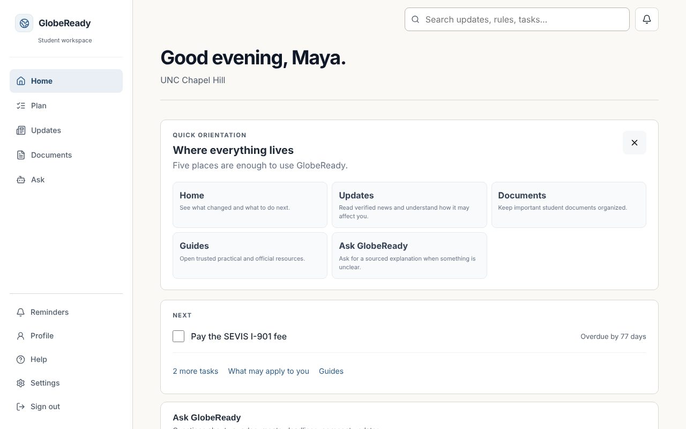
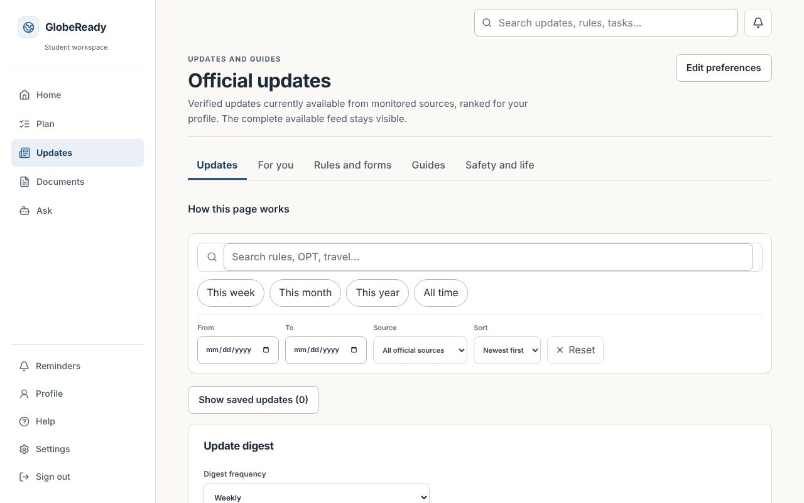
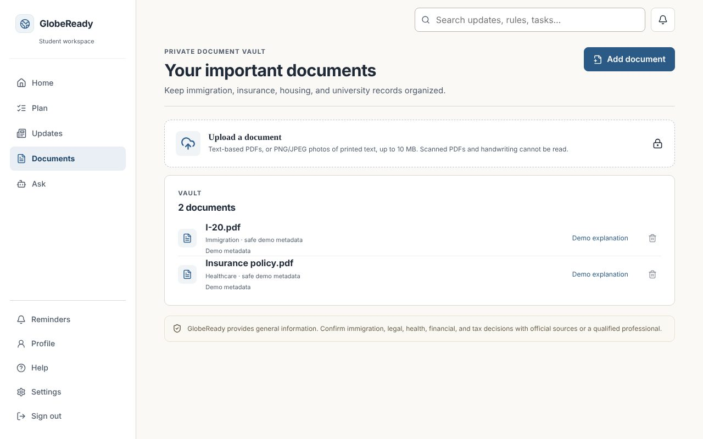

# GlobeReady

[](https://github.com/shlokbhutani13/globeready/actions/workflows/ci.yml)
[](LICENSE)

GlobeReady helps international students in the U.S. keep their deadlines, documents and official immigration news in one place. I'm an international student myself, and this information is usually spread across many websites and emails.

**Try it:** [globe-ready.web.app](https://globe-ready.web.app) (free public beta) · [Privacy](https://globe-ready.web.app/privacy)

> GlobeReady gives general information, not legal or immigration advice. Always check with your DSO or university.

| Home | Official updates | Documents |
| --- | --- | --- |
|  |  |  |

_Screenshots use demo data._

## What it does

- **Official news.** Every four hours it pulls updates from sources like ICE SEVP, Study in the States, NAFSA and the Federal Register. Anything not yet reviewed by a person is labeled that way.
- **Ask.** Search rules, guides and news and get back the exact passages with their sources. It never makes up an answer, and it tells you when nothing matches.
- **Plan.** Tasks, key dates, reminders and a calendar export.
- **Documents.** PDFs and photos are read with OCR right in your browser. Only the text is saved, with passport, visa and SEVIS numbers masked. The original file never leaves your device.
- **Your data.** Export it, restore it, or delete your account at any time.

## How it's built

- React + Vite front end, hosted on Firebase
- Firebase Auth and Firestore, with per-user security rules that check every write
- Express API with Firebase token checks, used in the full version (with Gemini answers and Cloud Storage)
- GitHub Actions for tests, the news feed and gated deploys

The free beta runs at $0: it's a static site plus Firestore, and documents are processed in the browser. The full version adds the Express API, Cloud Storage and Gemini answers. More detail in [docs/ARCHITECTURE.md](docs/ARCHITECTURE.md).

## Run it locally

You need Node.js 22. The quickest way to look around is demo mode, which uses sample data and no accounts:

```bash
cd server && npm ci && npm run demo    # terminal 1
cd client && npm ci && npm run demo    # terminal 2
```

For real accounts on your own computer, use the Firebase emulators (needs Java 21):

```bash
cd server && npm ci && cd ../client && npm ci
npm run local-user
```

Then open `http://127.0.0.1:5173`. Test logins are written to `.local/credentials.json`.

## Tests

```bash
cd server && npm test && npm run lint
cd client && npm test && npm run build
```

CI runs these, the Firestore rules tests and a Docker check on every push.

## Limits

- It's a beta. No expert has reviewed the visa content yet.
- The news comes from a short list of sources and can be late.
- The free beta has no email and no AI-written answers.

More docs: [modes](docs/MODES.md), [privacy](docs/PRIVACY.md), [security](SECURITY.md), [roadmap](docs/ROADMAP.md).

## License

MIT
