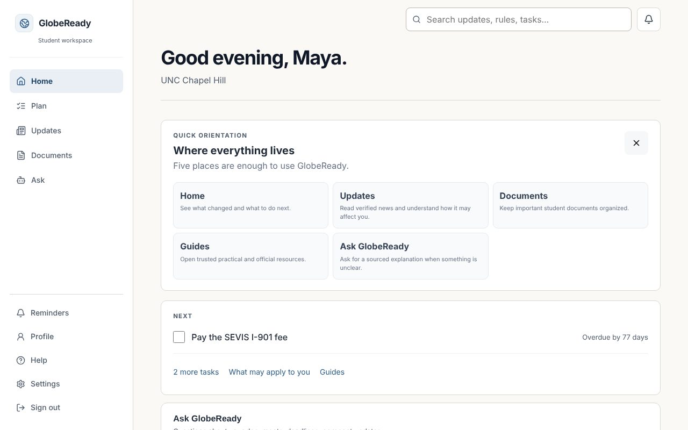
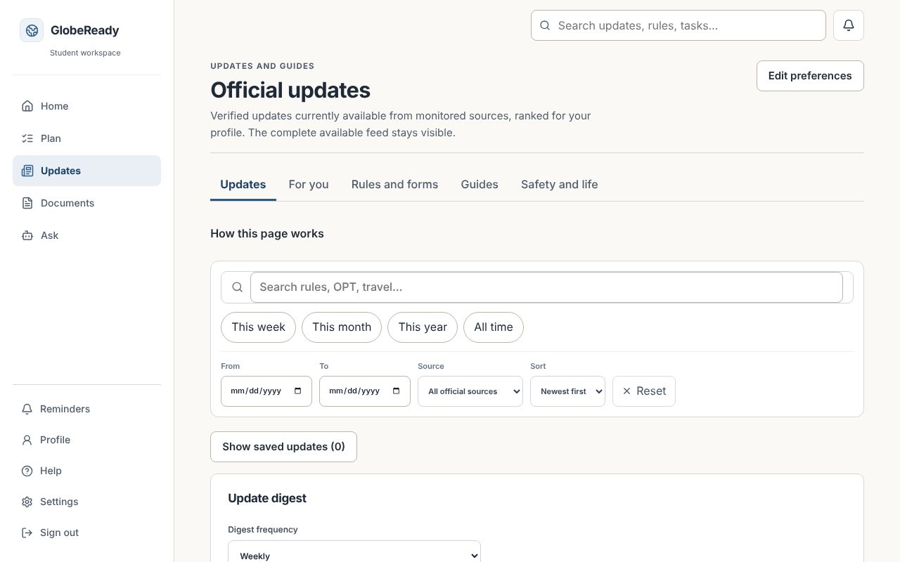
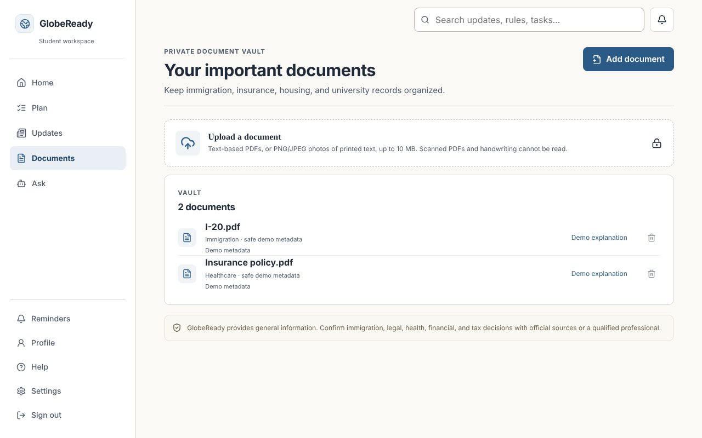
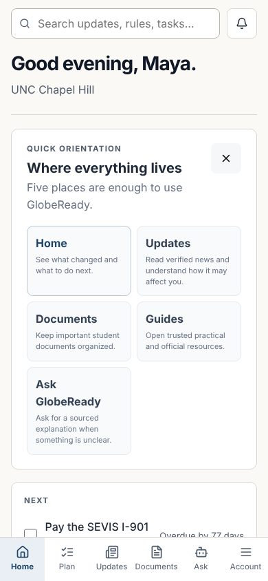
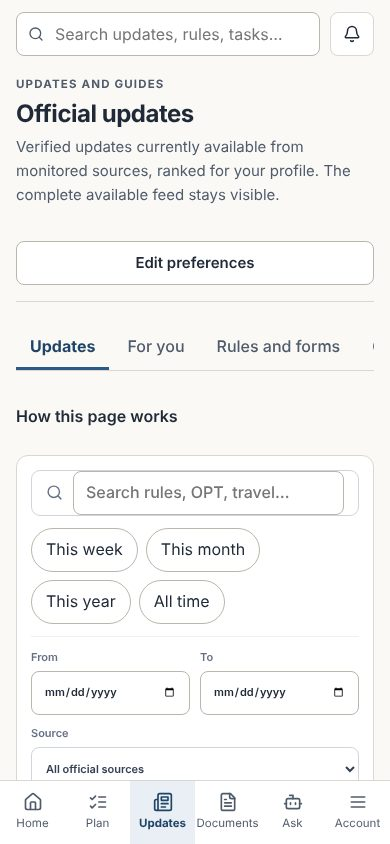
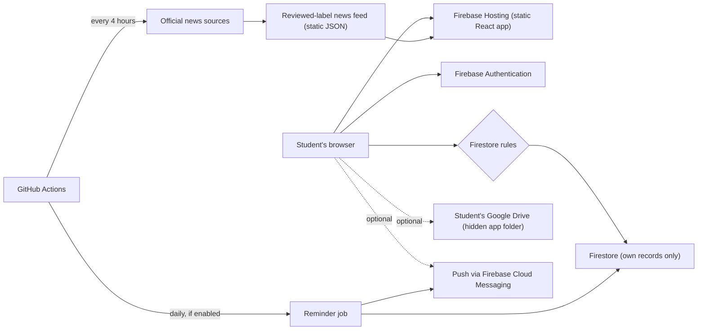
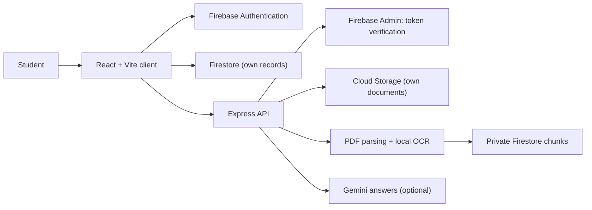

# GlobeReady

[](https://github.com/shlokbhutani13/globeready/actions/workflows/ci.yml)
[](LICENSE)
[](.nvmrc)
[](firebase.json)

**GlobeReady is a student workspace for international students in the United States.** It keeps deadlines, documents and official news in one place, answers questions only from sources it can cite, and gives students full control of their data. It is designed to run at **$0**.

**Live free beta:** <https://globe-ready.web.app> · [Privacy and your data](https://globe-ready.web.app/privacy)

GlobeReady provides general information, not legal, immigration, tax, health or financial advice. Confirm decisions with your Designated School Official (DSO), your university or the relevant government agency.

| Home | Official updates | Documents |
| --- | --- | --- |
|  |  |  |

<p>
  
  
</p>

_Screenshots are taken in demo mode with sample data._

## What it does

- **Official updates.** News collected every four hours from selected official sources, including MIT ISO, ICE SEVP, Study in the States, NAFSA and the Federal Register. Automatic stories are labelled "not yet reviewed by GlobeReady"; only records a person has reviewed carry the verified treatment.
- **Ask GlobeReady.** A sources mode that ranks passages from reviewed rules, guides, a plain-language glossary, resources and news, and shows each with where it came from. It never writes an answer, and it says so when nothing matches. A documents mode searches the student's own saved passages with page numbers.
- **Plan.** Tasks, key dates with reminders, a calendar export, and opt-in push reminders for dates and tasks that are close.
- **Documents.** PDFs and photos are read inside the browser (local OCR). The file is discarded; only extracted text is saved, with common passport, visa, receipt and SEVIS patterns masked. Optionally, originals can be kept in the student's own Google Drive, in a hidden app-only folder.
- **Your data.** JSON export and restore, a device-only backup of browser-stored tools, and account deletion with re-authentication.
- **Privacy page.** A public, plain-language statement of what is stored where, mirrored by tests against the code.

## Design decisions

- **Free to run, enforced in code.** The public beta is a static site plus Firestore, with browser-side document processing, so there is no server to pay for. The deploy refuses to run with an incomplete public configuration. Feature flags keep paid services (Cloud Storage, hosted AI, email) out of this mode.
- **Never guess.** Search returns cited passages or an explicit "nothing matched". Questions about the student's own case are referred to a DSO or an attorney. Generated answers are deliberately absent from the free beta, because free model tiers may train on what is sent to them.
- **Say what is verified.** Automatic news is labelled unreviewed, and the UI never claims comprehensive university coverage.
- **Data stays with the student.** Per-user Firestore rules validate every write, original files are never uploaded to GlobeReady, optional features are off until the student turns them on, and the privacy page is tested against what the code does.
- **Deploys are gated.** CI runs the full test suites; going live needs a manual approval in a protected environment.

More detail is in [docs/DECISIONS.md](docs/DECISIONS.md) and [docs/ZERO_COST_PUBLIC.md](docs/ZERO_COST_PUBLIC.md).

## Limitations

- It is a beta. No qualified reviewer has signed off on the visa-specific content yet.
- News is collected automatically from a short list of official sources and can be late or incomplete.
- There is no email delivery and no generated AI answers in the free beta.
- Optional Drive files are not encrypted by GlobeReady, so anyone who controls the student's Google account can open them.
- Push reminders on iPhone need the app added to the Home Screen.

## Architecture

Free public beta (the live site):



Full production (paid services; not what the live beta runs):



In production mode the API verifies identity on every protected request and derives the student from the verified token. In the free beta the browser talks to Firestore directly, so [`firestore.zero-cost.rules`](firestore.zero-cost.rules) validate every write.

## Run locally

Requirements: Node.js 22 (`.nvmrc`). Local-user mode also needs Java 21 for the Firebase emulators.

GlobeReady has four mutually exclusive modes:

| Mode | Start | What it is |
| --- | --- | --- |
| Demo | `npm run demo` in `server/` and `client/` | Sample data in memory; no account, no uploads. Development only. |
| Local-user | `npm run local-user` in `client/` | Real accounts, rules, uploads, and document reading, on the Firebase emulators on this computer. Persists across restarts. Development only. |
| Zero-cost public | `npm run build -- --mode zero-cost-public` in `client/` | Static signed-in beta: Firestore, local document processing, deterministic cited retrieval, and reviewed static news; no API, Storage, cloud AI, email, or push. |
| Production | Not started locally | Real Firebase only. Refuses to start without its full configuration. See [docs/CONFIGURATION.md](docs/CONFIGURATION.md). |

Local-user mode, from a fresh clone:

```bash
cd server && npm ci && cd ../client && npm ci
npm run local-user        # starts the emulators, seeds two synthetic accounts, starts the API and the app
```

Open `http://127.0.0.1:5173`. The seeded accounts and their passwords are in `.local/credentials.json` (ignored by git).
The Google button is a mock identity from the emulator; it is not your Google account. Stop with `npm run local-user:stop`,
and delete all local data with `npm run local-user:reset`. Details are in [docs/OPERATIONS.md](docs/OPERATIONS.md).

Demo mode:

```bash
cd server && npm run demo        # terminal 1
cd client && npm run demo        # terminal 2 (uses client/.env.demo, which contains no credentials)
```

Demo mode accepts the `x-demo-user` header as the identity. Production refuses it.

## Verification

```bash
cd server && npm ci && npm test && npm run lint && npm run test:rules
cd client && npm ci && npm test && npm run build
cd client && npm run build -- --mode zero-cost-public
```

`npm run test:rules` starts the Firestore, Auth, and Storage emulators (requires Java 21). It covers the security rules,
recursive account deletion, the account path with real Auth tokens and Storage objects, and the source-snapshot commit
under a lease. The production image is checked with `scripts/release/docker-fail-closed.sh <image>`. GitHub Actions runs
all of these on every push and pull request. Nothing is deployed by CI.

## Security and privacy

- Protected API routes derive identity from verified Firebase ID tokens, with revocation checks. Request bodies cannot select another student.
- Firestore and Storage rules restrict each student's records to their own UID. Retrieval chunks are server-only.
- Uploaded files are checked by declared type, real file signature, size, and exact private path, both at upload and again before reading.
- A university domain is registered only as pending until an administrator verifies it.
- Account deletion requires a recent sign-in and removes the student's stored data, in an order that can be retried.
- Generated answers are limited to retrieved evidence, and definitive legal or status conclusions are replaced with a referral.
- Production refuses to start without its full configuration, and never falls back to demo or local-user behavior.

Read [SECURITY.md](SECURITY.md) and [docs/PRIVACY.md](docs/PRIVACY.md) before configuring real identity documents.

## Documentation

- [V1 scope](docs/V1_SCOPE.md)
- [Data policy: retention, deletion, backup, and restore](docs/DATA_POLICY.md)
- [Modes: demo, local-user, and production](docs/MODES.md)
- [Configuration contract](docs/CONFIGURATION.md)
- [Operations: startup, shutdown, health, logging, local state](docs/OPERATIONS.md)
- [Deployment procedure](DEPLOYMENT.md)
- [Rollback and recovery](docs/ROLLBACK.md)
- [Smoke tests](docs/SMOKE_TESTS.md)
- [Release readiness](docs/RELEASE_READINESS.md)
- [Zero-cost public beta](docs/ZERO_COST_PUBLIC.md)
- [Architecture](docs/ARCHITECTURE.md)
- [Privacy model](docs/PRIVACY.md)
- [Security policy](SECURITY.md)
- [Roadmap](docs/ROADMAP.md)
- [Contributing](CONTRIBUTING.md)

## License

MIT
